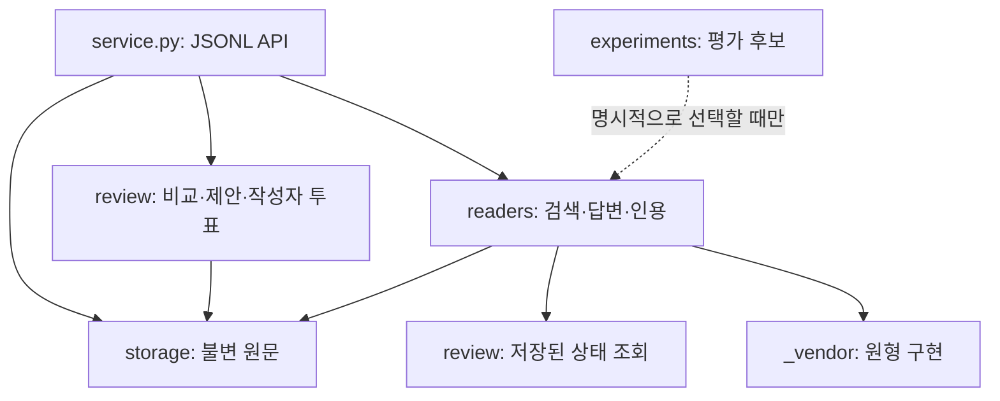

# 모듈 지도와 개발 경계

2026-11-14. 모듈 위치와 import를 정리한 변경이다. 모델·프롬프트·상태 전이·평가 기준은 유지한다. 모델 효과 검증은 [레퍼런스 연결 감사](reference-composition-audit.md)의 별도 동결 실행을 따른다.

서비스가 전체 흐름을 조정한다. 저장 모듈은 reader나 서비스에 의존하지 않는다. review는 모델 호출 함수를 주입받으며 GPU 서버를 직접 띄우지 않는다. readers는 검토 상태를 사용하고 사용자 대신 투표하지 않는다.

| 모듈 | 입력 → 출력 | 책임 | 맡기지 않는 판단 |
|---|---|---|---|
| `storage.sources` | 원문 envelope → source ID | 원문·작성자·시간 검증, 정확한 텍스트 보존 | 주장 의미·진실 판정 |
| `storage.objects` | JSON 객체 → 불변 파일/ID | 결정적 직렬화·해시·원자적 저장 | 모델/벡터 검색 |
| `review.comparison` | 원문·문장 ID → 관계 후보·오류 | 주입된 LLM 호출, 선택한 문장을 정확한 구절로 결합 | 승인·실험 실행 |
| `review.state` | 원문·후보·투표 → 제안·상태 | 구절 검증·기록·중복 방지·상태 축약 | QA 해석을 사실로 확정 |
| `readers.context` / `state_citations` | 관계·원문·투표 → 독해 문맥·상태 근거 | 조건·상태와 원문을 구분해 전달 | 관계 오분류를 자동 교정 |
| `readers.retrieval` | 질문·저장소 → 근거가 붙은 초안 | LlamaIndex 검색·문맥 예산·출처 위치 복원 | 유사도로 승인 여부 확정 |
| `readers.checking` | 초안·근거 → 문서 판정·수정 | 현재 ConflictScore 어댑터와 진단 정보 | 전체 논문 재현·의미 정답 인증 |
| `readers.attribution` | reader 결과 → 조건부 AQA·공통 인용 | direct/attributed 구성과 기존 보완 연결 | 출처 ID 커버리지로 정답 인증 |
| `readers.citations` | 답·원문 → 인용 위치·누락 경고 | 미인용 문장에 구절 연결, 답 문구 보존 | 모든 기존 인용의 의미 검증 |
| `service` | JSONL 요청 → JSONL 응답 | 저장·검토·QA 조정, 오류/상태 반환 | 인증·MCP·Git 원격 전송 |

파일·함수 안내: [storage](../team_memory/storage/README.md), [review](../team_memory/review/README.md), [readers](../team_memory/readers/README.md).

## 의존성

- `storage`와 `review.state`는 표준 라이브러리로 동작한다.
- `review.comparison`의 문장 구분은 NLTK를 사용한다. 분류 모델은 호출자가 전달한다.
- `readers`는 reference 의존성을 사용하는 선택적 계층이다. 패키지 import만으로 가중치를 내려받거나 서버를 시작하지 않는다.
- `experiments`는 기본 서비스에 자동 연결하지 않는다. 과거 CLI의 명시적인 profile 선택은 유지한다.
- `_vendor` 원본과 라이선스는 보존한다. 프로젝트 변형은 어댑터에 두고 차이를 기록한다.
- 운영 모듈이 `evaluation`의 정답 키나 `results`를 읽어서는 안 된다.

## 호환성과 과거 경로

기존 평면 경로는 새 구현과 **같은 Python module 객체**를 가리키는 얇은 호환 파일이다. 기존 import, private 함수 접근, monkeypatch와 CLI를 유지한다. 새 로직은 호환 파일이 아닌 실제 구현에 넣는다. [전체 경로 대응표](module-paths.json).

예외는 `team_memory/store.py`다. 과거 QA 데이터 생성 manifest가 이 파일의 정확한 바이트를 검증한다. 원본을 유지하고 `storage.objects`가 그 구현을 참조한다. 구조 정리를 이유로 데이터셋의 고정 해시를 바꾸지 않는다.

루트에 남은 `core`, `merge`, `qa`, `premise`, `reconsider`, 초기 `*review` 후보, `cupmem_*`, `workbench` 등은 초기 실험·baseline·데모 재현 경로다. 현재 서비스에 모두 붙은 모듈이 아니다. [연구 이력](research-history.md)을 기준으로 읽고 새 운영 기능은 위 모듈 경계에 추가한다. 동결 재현에 묶인 과거 파일을 무리하게 이동하지 않는다.

## 개발과 패키징

1. API/저장 형식 변경은 기존 ID·원문·상태와의 호환 정책부터 정한다.
2. 운영 변경은 해당 모듈에, 모델 후보는 `experiments/`, 평가 로직은 `evaluation/`에 둔다.
3. `scripts/check.py core`와 `reference --fail-on-skip`은 CI와 동일한 선택을 사용하며 함수형 pytest 테스트도 포함한다.
4. 새 배포 패킷은 `python -m team_memory.packaging code.tar.gz`로 만든다. 평면 파일 몇 개만 복사하면 하위 패키지·vendor 자료가 빠질 수 있다.
5. 과거 동결 실행은 해당 `code.tar.gz`와 manifest로 재생한다. 현재 소스와 과거 해시가 다르면 새 실행 버전을 만들고 과거 해시를 덮어쓰지 않는다.

이번 구조 변경의 검증 대상은 동일한 프로그램 동작, 호환 import, 패키징과 의존성 경계다. 모델 성능 개선을 주장하지 않는다.

검증 기록: [331개 검사·87개 하위 사례, 패키지/호환성 확인](module-layout-verification.json). 모델 추론 점수는 포함하지 않는다.
