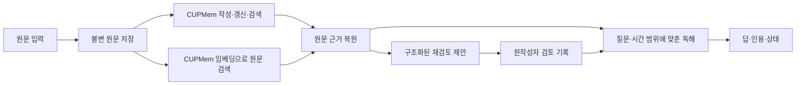

> 보존한 이전 README. 아래의 “현재/최신”은 각 작성 당시 표현이며 현재 권장 경로는 [루트 README](../README.md)를 따른다. 기존 실험 설명을 삭제하지 않기 위한 이력 문서다.

# Evidence-Bounded Team Memory

[](https://github.com/ashcircle03/evidence-bounded-team-memory/actions/workflows/tests.yml)

팀원 각자의 AI가 Git으로 실험 기록을 주고받을 때, **과거 결정은 어떤 조건에서 내려졌고 새 근거가 들어오면 무엇을 다시 검토해야 할까?** 원문을 보존하고, 작성자가 검토할 병합 제안을 만들고, 각 답을 당시 출처까지 추적하는 연구 프로토타입이다.

[데모](#데모) · [시스템 구조](#시스템-구조) · [실험 결과](#실험-결과) · [재현 안내](../evaluation/cpython/README.md) · [기여 안내](../CONTRIBUTING.md)

현재는 **CUPMem 기반 후보의 구현과 고정 비교 평가를 완료했으며, 후보를 기본 경로로 채택하지 않기로 했다.** 원문 저장·검색·한 번의 독해·작성자 검토 상태를 개발 기반으로 유지한다. 긴 원문 처리와 의미적으로 근거 있는 재검토는 아직 해결하지 못했다. [최종 결과와 설계 판단](../results/cupmem/practical/README.md) · [문항별 실제 답·제안·인용](../results/cupmem/practical/cases.md)

## 현재 구현과 확인 범위

**팀원이 연결할 단일 진입점은 `python -m team_memory.service`다.** 기존 `AttributedQA`와
`timeline`의 원작성자 검토를 같은 원문 저장소에 연결했다. 새 입력은 공백까지 보존하고,
출처 날짜·정정 양쪽 근거·실제 승인 상태를 QA에 전달한다. UI/MCP와 Git 전송은 호출자가
맡는다. [입출력·실행 방법](../docs/service-v2.md) · [검증 결과와 남은 한계](../results/service-v2/README.md)
아래 profile·practical 결과는 각 실험의 범위이며 새 통합 경로의 성능으로 합산하지 않는다.

최신 후보는 LongMemEval의 실제 검색·시간순 독해와 ALCE 문단 ID 인용을 연결했다. 기존20의 direct 정답19/20·답과 인용18/20, Ever10의 엄격한 답·근거는 BM252/10·Contriever1/10으로 기본 경로를 교체하지 않았다. [전체 비교와 실패 원인](../results/reference-qa/documents-v1/README.md) · [입출력과 설계 의도](../docs/reference-documents.md)

후속 검색·맥락 보존 후보를 같은 Ever10과 기존20에서 검증했다. Ever의 답·근거는 독해만 수정2/10, 검색만 수정1/10, 결합2/10이며 이전 단순 독해도2/10이었다. 결합 후보의 기존20은17/20으로 보존 기준을 통과하지 못했다. `contextual`은 실험용 프로필이며 기존 `attributed`를 유지한다. [문항별 변화·실패 원인·비용](../results/reference-qa/contextual-v1/README.md) · [레퍼런스 연결](../docs/reference-contextual.md)

상태 유실과 JSONL 출력 혼입을 수정했다. 주장별 근거를 먼저 선택하는 `claims` 후보는 인용 형식 복구 후 기존 QA 20문항 중 17개에서 답과 근거를 보존했다. 이전 14/20에서 개선됐지만 기존 QA의 선택 경로는 `attributed`를 유지한다. 이번 검증은 고정 출력 104개 재생과 Qwen 최종 생성 5회이며, 기존 성공 48개를 모두 보존하고 출력 7개를 복구했다. Ever 개발 10문항의 입력은 충분 4개·일부 누락 4개·핵심 근거 부재 2개로 나뉘었다. [최신 수정·문항별 진단·한계](../results/reference-qa/format-recovery-v1/README.md) · [수정 전 확대 평가](../results/reference-qa/claims-v3/README.md)

후속 원문 QA는 LlamaIndex 혼합 검색·작성자 전달·ConflictScore 문서 검토 위에 **AQA의 출처별 답 보존과 LangChain의 근거 구절 인용**을 연결한 `--profile attributed` 경로다. 같은 Qwen3-8B와 고정 개발20문항에서 **19/20 → 20/20**, 기존19개 답·근거 보존과 부연 인용 누락2건 복구를 확인했다. 추가 인용13개에서 새 오인용은 찾지 못했다. 실제 모델 호출의 고정 재생과 원문 대조 결과이며, 전체 벤치마크 성과나 완전한 자동 인용을 뜻하지 않는다. [문항별 결과·비용·한계](../results/reference-qa/README.md) · [설계 의도·공개 구현 재사용](../docs/reference-attribution.md)

후속 단순화 비교에서는 같은 모델·검색의 새12개 통제 사례에서 `attributed`가7/12, 한 번에 답·근거를 생성하는 `joint`가9/12였고 호출은51→12로 줄었다. 그러나 joint는 기존20개 중1개를 잃고 같은 문서 내 상충의 순서 반전에 실패해 **전면 교체하지 않았다.** 기존 경로에는 부가 단계 예외가 나도 이전 답·근거를 보존하는 수정만 채택했다. 기존20개 출력은 정확한 재생으로 보존됐으며 새12개는 독립 자연 벤치마크가 아니다. [실제 비교·미해결 오류](../results/reference-qa/simplify-v2/README.md) · [재사용 근거와 단순화 설계](../docs/reference-joint.md)

이전 practical 평가의 호출 경로는 `team_memory.cupmem_practical.PracticalCUPMemService`다. `strategy='simple'`은 원문 검색·독해를 사용하며, 실험 후보 `strategy='cupmem'`은 공식 기억 작성·후보 검색과 후보별 재검토를 연결한다. QA는 두 경로 모두 원문과 실제 검토 상태를 받아 한 번 독해한다. [모듈별 책임과 고정 명세](../docs/cupmem-practical-v2.md) · [Python·JSONL 사용법](../docs/practical-usage.md)

알려진 Cedar 개발 흐름에서는 후보 QA 5/5, 무관한 입력의 제안 0건, QA당 모델 호출 1회를 확인했다. 실제 Qwen3-8B JSONL 예제도 실행했다. 고정 평가의 결과는 다음과 같다.

| 항목 | 단순 검색·독해 | CUPMem 후보 |
|---|---:|---:|
| 기존 QA 내용 정답 | 12/20 | 9/20 |
| 기존 QA 답과 인용 모두 정답 | 7/20 | 7/20 |
| 새 사례의 근거 있는 재검토 | 0/10 | 0/10 |
| 대상 결정과 재검토 종류만 일치 | 5/10 | 7/10 |
| 음성 사례의 불필요 제안 | 0/10 | 0/10 |
| 음성 사례의 오류 없는 올바른 무제안 | 9/10 | 9/10 |

새 20흐름은 실제 후속 기록 10개를 양성/음성으로 짝지은 통제 구성이다. 기존 QA 중 자연 EverMemBench 문항은 3개이며 두 경로 모두 2/3이다. 의미 판정은 개발에 참여한 AI 한 명이 원문과 대조한 결과로, 독립된 사람의 검증은 아니다. [고정 평가 기준](../evaluation/cupmem/practical/PROTOCOL.md) · [실행·실패 상태](../results/cupmem/practical/progress.json)

긴 문서의 독해 입력은 문맥 한도를 넘었고, native 적재 실패는 후보 QA 10문항을 차단했다. 선택한 인용은 416/416개가 원문과 일치했지만 설명을 지지하지 못하는 경우가 반복됐다. 전체 goal 비용은 실패와 개발을 포함해 194.10 GPU분이다. 원형 CUPMem·SpeakerMem-R1 성능 재현이나 일반적인 문제 해결을 주장하지 않는다. 기존 구현의 constructor 기본값은 실험 고정을 위해 유지했으므로 호출자는 `strategy`를 명시해야 한다.

## 이전 통합 개발 경로: service-v1

통합 호출 경로는 `team_memory.cupmem_service.CUPMemService`다. 원문 저장, CUPMem 갱신·검색, 원문 검색·복원, 구조화된 재검토, 작성자 검토, QA를 연결한다. [입출력·상태·실패 처리 명세](../docs/cupmem-service-v1.md)에 각 모듈의 책임과 재사용 근거를 고정했다. 이 명세와 실제 모델 성과는 구분한다.

```python
from team_memory.cupmem_adapter import CUPMemTeamMemory
from team_memory.cupmem_service import CUPMemService

# engine: 공식 CupMemEngine
# recorded_calls(): 실제 native LLM 요청과 응답의 목록
# generate(system, content): 최종 독해용 모델 호출 함수
memory = CUPMemTeamMemory(engine, recorded_calls)
service = CUPMemService(memory, generate, "team-records")
received = service.handle({"operation": "ingest", "source": report})
answer = service.handle({
    "operation": "ask", "question": "조건별로 어떤 결과가 나왔어?",
    "temporal_scope": "historical",
})
```

`report`는 아래의 원문 형식(`owner`, `observed_at`, `source`)을 사용한다. 모델이 만든 결론·조건을 사람이 미리 정리해 넣지 않는다. 호출자는 `status`, 최종 `answers`, 검토할 `proposals`를 사용하며, 원형 답은 `native`의 진단 자료다. 재시작 시 원문·검토 기록은 남고 파생 엔진은 명시적인 `rebuild`가 필요하다. 재구축은 모델 호출을 수행한다. [실제 실행 연결 예제](../evaluation/cupmem/service_run.py)



하위 어댑터 `team_memory.cupmem_adapter.CUPMemTeamMemory`는 공식 `CupMemEngine`을 주입받아 사용한다. `ingest(source)`는 원형 `write_session`으로 기억을 만들고 갱신하며, 후속 기록에는 원형 `answer_query`를 통해 재검토 필요성을 묻는다. `ask(question)`도 원형 검색·전제 확인·답변 생성을 사용한다. 어댑터는 작성자·시각·원문을 보존하고, 실제 최종 답변 생성 요청의 근거 참조를 원문 기록까지 연결한다. 원형 답변은 보존한다. 단독 어댑터의 `source_generate`는 선택된 기억의 원문만 펼쳐 읽는 이전 개발 경로다. 현재 서비스는 이 옵션을 끄고 CUPMem의 임베딩으로 원문 구절도 검색한 뒤 한 번의 최종 독해로 연결한다. [어댑터 설계](../evaluation/cupmem/TEAM_ADAPTER_DESIGN.md) · [현재 서비스 명세](../docs/cupmem-service-v1.md)

현재 출발점은 공개 코드 `icedreamc/STALE`의 CUPMem revision `ea7d391103a151927cd29d2f01d87597a782bdcb`다. Qwen3-8B를 사용한 대체 모델 개발 실행이며, SpeakerMem-R1을 주 베이스라인에서 교체했다는 결정이나 논문 성능 재현을 뜻하지 않는다. 주 베이스라인 비교와 현재 동작 경로를 구분한다.

생성된 재검토 권고는 승인이 아니다. 호출자가 원작성자의 의사를 받아 `review`를 호출하면 서비스가 검토 기록을 저장한다. 사용자 인증과 Git 전송은 호출자가 맡는다. 원문 인용의 위치 검증과 답의 의미 정확성은 구분한다.

**현재 통합 실행은 Qwen3-8B로 합성 개발 흐름 하나를 처음부터 끝까지 수행했다.** 조건이 바뀌자 근거를 붙인 재검토·공존 제안을 각각 만들었고, 무관한 기록에는 제안을 만들지 않았다. 질문 3종을 검토 전후 총 5회 물어 사전에 정한 답과 인용 요건을 모두 충족했다. 인용 8개는 원문 위치와 일치했고, 중복 입력은 추가 모델 호출 없이 처리했다. 작성자 승인은 가상 작성자의 명시적 호출로 재생했다. GPU 1개를 16분 59초 사용했고 모델 호출은 86회였다. [결과·제약·재검증 방법](../results/cupmem/service-v1/README.md) · [실제 답과 근거](../results/cupmem/service-v1/comparison.json)

이는 알려진 작은 합성 흐름의 개발 결과다. 재검토 설명의 과도한 무효화 표현과 호출 비용이 남아 있으며, 일반 벤치마크 성과·기존 QA 20개 보존·단순 원문 독해보다 나은지는 아직 확인하지 않았다. 이전의 질문 4개 원문 독해 재생은 별도 기록으로 남긴다: [이전 원형 답·독해 결과](../results/cupmem/team-adapter/comparison.json) · [이전 실행 범위](../results/cupmem/team-adapter/summary.json).

## 진단용 코어: 입력 → 판단 / 답변

팀의 MCP 연결과 UI는 별도 작업이다. `team_memory.core.compare_records(earlier, incoming, generate)`와 `answer_question(records, question, generate, relations=None)`는 진단용 함수다. 현재 CUPMem 경로에서는 `answer_question`을 선택된 원문의 최종 독해·인용 처리에 재사용한다. `generate(system, content)`를 주입하므로 특정 서버·UI에 의존하지 않는다. 원문 형식은 `owner`, `observed_at`, `source: {speaker, location, text}`이며 `relations`에는 실제 승인 상태만 전달한다.

JSON 입력으로 바로 실행하려면 `python3 -m team_memory.core_cli --job JOB_ID --input request.json`을 사용한다. QA 요청은 `{"operation":"qa","records":[...],"question":"..."}`, 비교 요청은 `{"operation":"compare","earlier":[...],"incoming":{...}}`다. `JOB_ID`는 실행 중인 Aurora 모델 작업이며 새 작업을 자동 제출하지 않는다.

모델은 근거 구절 ID를 고르고 코드가 원문·출처·위치를 붙인다. 결과는 `status`, `answers` 또는 `relations`, `warnings`, `raw`를 제공한다. 근거 위치의 일치와 답의 의미 정확성은 구분하며, 제안은 항상 `pending`이다. 저장과 작성자 승인 처리는 호출자가 담당한다. 기존 동결 평가 경로는 변경하지 않았다. 중단한 웹 UI 코드는 개발 기록으로만 남긴다.

## 데모

Python 3.12와 Git이 있으면 모델 다운로드 없이 두 팀원의 작업을 재생할 수 있다.

```sh
git clone https://github.com/ashcircle03/evidence-bounded-team-memory.git
cd evidence-bounded-team-memory
python3 -m team_memory demo
```

첫 번째 팀원은 시간 분할에서 성능 개선을 관측하지 못했다. 두 번째 팀원은 그룹 분할에서 개선을 관측하고 기록을 올린다. 데모는 임시 Git 저장소와 두 복제본으로 이 상황을 재현한다. 출력 JSON에서 다음 세 지점을 비교할 수 있다.

| 출력 필드 | 확인할 판단 |
|---|---|
| `after_pull_before_review` | 첫 팀원의 AI가 새 기록을 읽을 수 있다. 기존 기록은 승인 상태, 새 기록은 검토 대기 상태로 표시된다. |
| `after_both_reviews_and_pull` | 분할 조건이 다른 두 관측이 각각 출처를 갖고 남는다. |
| `unresolved_pair` | 같은 분할에서 상반된 결과가 나오면 양쪽 근거가 남는다. 이후 명시적으로 승인한 정정의 효과는 `after_explicit_correction`에서 볼 수 있다. |

이 데모의 관측값과 승인자는 가상이다. 실제 외부 문서를 사용한 평가는 아래에 따로 실었다.

## 이전 최소 시스템 구조

앞선 누적 흐름 실험에서 선택한 경로는 **원문 직접 읽기 + 출처·검토 상태 관리**다. `python3 -m team_memory.timeline_cli`의 기본 모드는 `direct`다. [사용법](../evaluation/timeline/README.md) · [당시 설계 판단](../results/timeline/interpretation.ko.md) · [20개 흐름의 실제 답과 인용](../results/timeline/cases.ko.md)

각 팀원은 자신의 체크아웃에서 CLI를 사용한다. Git이 기록을 전달하고 각 클라이언트가 같은 기록에서 검토 상태를 다시 계산한다.

| 단계 | 동작 | 구현 |
|---|---|---|
| 기록 | 원문·출처·관측 시점을 불변 객체로 저장한다. | [store](../team_memory/store.py) |
| 새 기록 처리 | 클라이언트별 처리 위치를 유지하고 이미 읽은 원문과 새 기록을 비교한다. | [timeline client](../team_memory/timeline_cli.py) |
| 제안·검토 | 출처 구절을 붙인 제안을 만들고 원작성자의 명시적 검토를 별도로 기록한다. 정정은 해당 구절에만 적용한다. | [timeline](../team_memory/timeline.py) |
| 질의 | 현재까지 처리한 원문과 실제 검토 상태를 읽고 답·인용·조건을 검사한다. | [timeline QA](../team_memory/timeline.py) |

최소 시스템 명령은 `python3 -m team_memory.timeline_cli --help`로 볼 수 있다. 이전 CLI와 연구 모듈은 호환성·재현을 위해 보존하며, 위의 최소 경로와 구분한다.

## 이전 실험 결과

기록 유입부터 제안·작성자 검토·QA까지 연결하는 [최소 시스템](../evaluation/timeline/README.md)을 같은 Qwen2.5-14B로 비교했다. 원문 직접 읽기와 자동 색인 추가는 관계 종류·설명까지 맞힌 검토가 각각 8/12·7/12, 검토가 불필요한 흐름의 오탐은 5/8·3/8이었다. QA는 양쪽 111/140이지만 색인 추가로 기존에 맞히던 7개 시점을 잃었고, 원출력에는 해당 답이 있어 출력 종류·인용 검증에서 탈락한 것으로 확인했다. 기본값은 단순한 `direct`로 정한다. 원문·검토 상태 관리의 실행 가능성을 확인했으며, 자동 재검토와 누적 QA의 신뢰성에는 아직 문제가 남아 있다. [최종 결과와 해석](../results/timeline/interpretation.ko.md)

고정 Git 사건 15개에서 설계 유지 여부를 비교했다. Qwen2.5-14B에서 원문 참조를 포함하면 단순 방식과 현재 모듈 모두 근거 있는 재검토 7/15, 음성 오탐은 각각 4/15와 1/15였다. 참조를 가리면 단순 방식은 6/15, 모듈은 3/15였고 오탐도 남았다. 출처·승인 상태·기존 QA는 유지하되 일반 재검토는 단순화해 재설계하는 판단이다. 기존 QA 회귀 검사 20/20은 보존됐다. 과거에 사용한 진단 사례와 한 AI 평가자의 채점 결과이며 새 사건 일반화 성과가 아니다. [설계 유지 판단](../results/design_review/README.md) · [구성요소별 결정](../results/design_review/decision.ko.md)

같은 새 Git 보고에 실제 재검토 대상과 주제만 비슷한 결정을 붙여 평가했다. 독립된 후속 보고 5건에서 Git의 명시적 회귀 참조를 활용한 전략은 무관한 두 결정에 대한 오탐을 5/5에서 0/5로 줄였고, 3/5에서 과거·신규·대안 원문 구절을 모두 찾았다. 설명까지 정확한 제안은 0/5여서 기본값 채택을 보류했다. [같은 보고에서 결정을 구별한 실험](../results/contrast_review/README.md)

후속 실험은 설명의 주체·동작·조건을 원문에 연결한다. 개발 3건은 세 역할을 모두 복구했지만, 새 Git 보고 5건에서 실패 동작까지 근거를 갖춘 제안은 직전 방식과 같은 0건이었다. 기존 QA의 답과 인용은 20/20 유지됐다. [역할별 근거 검증](../results/role_review/README.md)

문맥 확장 후속 실험에서는 개발의 git fsck 오류·조건을 복구했고, 새 Git 5건에서 근거 있는 제안을 역할 검증 방식의 0건에서 1건으로 늘렸다. 앞선 참조 방식도 다른 1건을 맞혀 순증가는 없었다. 무관한 결정의 오탐은 0/5, 기존 QA 답·인용은 20/20 일치했다. [문단 주변의 근거 복구 실험](../results/context_review/README.md)

올바른 과거·신규 문단을 지정한 판정 실험에서 새 전략은 근거 있는 제안을 0/6에서 3/6으로 늘렸다. 실제 Git 원문에서 직접 시작하면 적중은 두 방식 모두 0/6이고 오탐은 0/6에서 5/6으로 늘어 기본 채택을 보류했다. 기존 QA 성공 20문항의 답과 인용은 보존됐다. [판정·설명 분리 검증](../results/fixed_review/README.md)

과거 후보를 하나씩 비교하는 실험적 `pull --strategy pairwise`는 새 Git 양성 4건 모두에서 후보 순서를 뒤집어도 올바른 과거·신규 문단을 찾았다. 같은 쌍에서 새 보고를 먼저 보여주면 문단 적중이 2/4로 떨어졌다. 기본 표시 순서에서도 재검토 이유까지 맞게 전달한 결과는 0/4여서 기본값 채택은 보류했다. 기존 성공 QA는 원래 추론 배치를 복원했을 때 20/20에서 정답과 인용이 같았다. [과거 근거 선택 평가](../results/pair_selection/README.md)

**두 번째 평가에서는 자동 재검토와 QA를 각각 기본값 채택 보류로 판정했다.** 새 사건 40건에서 불필요한 제안은 9/10에서 0/10으로 줄었고, 그중 명시적으로 유지한 경우는 6/10이었다. 필요한 재검토는 두 방식 모두 4/10, 일반 QA는 모두 3/10이었다. 답이 갈리는 문항에서 두 답과 근거를 보존한 경우는 0/10에서 2/10으로 늘었다. 원문 Markdown을 Git으로 주고받는 두 복제본의 실행과 문항별 판단을 공개한다. [두 번째 평가](../results/revision/README.md) · [문항별 결과](../results/revision/cases.ko.md) · [재현 명령](../evaluation/revision/README.md)

**첫 번째 파일럿에서 후보 모듈은 기본값으로 채택하지 않았다.** 같은 Qwen이 답과 출처를 함께 맞힌 일반 QA는 단순·후보 모두 6/10이었다. 무관한 충돌로 잃은 기존 정답은 양쪽 모두 0/6인 반면, 양쪽 답과 근거를 보존한 실제 상충 변형은 양쪽 모두 0/10이었다. 후보의 재검토는 필요할 때 7/10을 맞혔고, 불필요한 경우에도 10/10에서 제안했다. [전체 성과와 채택 판단](../results/team_pilot/README.md) · [문항별 비교](../results/team_pilot/cases.ko.md) · [측정한 응답으로 두 복제본 재생하기](../evaluation/team_pilot/README.md#실제-qwen-응답으로-git-재생하기)

### 이전 개발 결과

CPython PEP 초안 3건을 첫 공개 시점으로 복원했다. 사전에 정한 목표 5개에서 **대상 문서와 후속 조치를 모두 맞힌 횟수**는 단순 검색+Qwen이 2/5, 재검토 모듈이 1/5였다. 이 파일럿에서는 단순 검색을 기준선으로 유지한다. [목표별 비교와 당시 원문](../results/cpython/report.ko.md)

두 방식이 공유하는 QA에서는 **정답 구절이 모델 입력에 9/9 있었고, 답과 출처를 함께 맞힌 결과는 0/9**였다. Qwen은 6번 기권했고 나머지 3번도 질문의 답을 담지 못했다. 같은 모델에 같은 문서로 인용 없이 답만 요청하면 2/9, 정답이 있는 구간을 미리 알려주고 답만 요청하면 8/9였다. 후자는 병목을 찾기 위한 사후 대조다. [문항별 QA 진단](../results/cpython/qa-diagnosis.ko.md) · [GPU 원출력](../results/cpython/outputs.json) · [대조 실험 원출력](../results/cpython/qa-control-outputs.json)

- [CPython 평가 재현](../evaluation/cpython/README.md) — GPU 없이 모델 입력을 복원하고 저장된 응답을 재채점한다.
- [사전 평가 계획](../evaluation/cpython/PLAN.md) — 평가 대상과 성공·보류 조건을 확인한다.
- [Aimers 및 EverMemBench-Dynamic 개발 기록](../results/development.ko.md) — 초기 설계와 개발셋 결과를 읽는다.

## 새 기록을 받은 팀원의 작업 흐름

```sh
python3 -m team_memory demo --followup
```

이 데모는 두 Git 복제본에서 라우팅 실험의 기각 기록과 후속 측정 결과를 주고받는다. 새 기록을 받은 팀원의 검토함에 두 원문과 제안이 생기고, 작성자 승인 전에는 `pending`, 승인 뒤에는 `approved_review`가 표시된다. 재검토 승인 후에도 두 관측은 보존된다. 데모의 모델 응답은 고정되어 있어 Git 동작과 승인 절차를 오프라인으로 확인할 수 있다.

실제 저장소에서는 각자의 가중치 경로와 Git으로 공유하는 기록 폴더를 지정한다. 팀원은 원문을 `capture`하고 해당 기록을 커밋해 push한다. 상대 팀원의 `pull`은 fast-forward 후 새 원문을 이전 결정들과 비교한다. 특정 과거 결정 ID를 지정할 필요가 없다. CLI의 `--store` 기본값인 `team-records/`는 이 연구 저장소에서 무시되므로, 공유 데모에서는 별도 경로를 사용한다.

```sh
python3 -m team_memory --store shared-records capture report.json
git add shared-records && git commit -m 'Record experiment' && git push
# 다른 복제본에서
python3 -m team_memory --store shared-records pull --model /path/to/Qwen2.5-3B-Instruct
python3 -m team_memory --store shared-records inbox
python3 -m team_memory --store shared-records ask "What changed for cached routing?" --strategy simple --model /path/to/Qwen2.5-3B-Instruct
```

`report.json`의 필드는 `owner`, 시간대가 있는 `observed_at`, 그리고 `source`의 `speaker`, `location`, `text`다. 검토함의 `id`, `proposal`, `reviewer`로 `review ID PROPOSAL REVIEWER approve`를 실행한다. 제안과 검토 기록도 팀원들이 받도록 커밋하고 push한다. CLI의 작성자 이름은 팀이 제출한 값이며 원격 사용자의 신원 인증은 Git 호스팅의 접근 제어가 담당한다.

[QA·재검토 파일럿의 사전 기준과 재현 명령](../evaluation/team_pilot/README.md)
