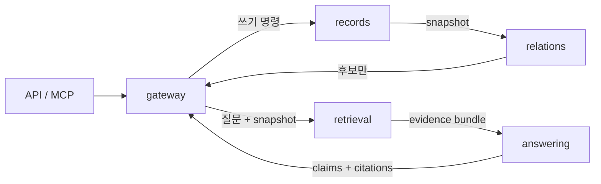

# 팀 개발 계약 v1.1

2026-11-15 · `team-memory.modules/v1.1`

**협업 단위는 records / relations / retrieval / answering / gateway 다섯 개다.** 책임, 입출력, 상태 변경 권한, 실패의 영향 범위, 독립 검증 가능성을 기준으로 나눈다. 논문의 개별 기법이나 파일 수가 모듈 수를 결정하지 않는다. ConflictScore·수정·AQA는 answering 내부에서 교체할 수 있는 전략이다.

실제 어댑터가 [`connect_v2`](runtime.md)로 연결됐다. 기존 `service.py`의 `team-memory/v2` API와 구분되는 opt-in 경로다. v1.1은 기존 무인용 답변 구절을 잃지 않는 original_text/unattributed와 answer_span, 이전 비교 history IDs를 추가한다. 아래 구현 범위와 [검증 결과](../../results/module-adapters/README.md)를 함께 읽는다.

## 다섯 개발 단위

| 모듈 / 담당 범위 | 입력 → 출력 | 쓸 수 있는 상태 | 독립 개발의 완료 기준 |
|---|---|---|---|
| [records](records.md) / 저장·상태 | 원문·제안·검토 명령 → receipt / immutable snapshot | 원문, 제안, 승인 이벤트, 버전만 이 모듈이 기록 | 원자성·권한·재시도·변경 범위 검사 |
| [relations](relations.md) / 의미 비교 | 고정 snapshot·새 기록·과거 후보 IDs → 근거 있는 관계 후보 | 없음 | 공존/상충/정정/재검토 구분, 잘못된 구절·실패 분리 |
| [retrieval](retrieval.md) / 검색·근거 구성 | 질문·시점·조건·snapshot·예산 → evidence bundle | 검색 인덱스/캐시만; 팀 지식 변경 금지 | 원문·메타데이터·상태 전달, 검색 실패 분리 |
| [answering](answering.md) / 답변·검사·인용 | 고정 evidence bundle → claims + 각 claim의 evidence IDs | 진단 로그만; 팀 지식 변경 금지 | 현재값·대안·보류·주장별 근거 연결 |
| [gateway](gateway.md) / API·MCP 조정 | 인증된 사용자 요청 → 모듈 호출·응답 | records 포트를 통한 명시적 명령만 | 읽기/쓰기 경로 분리, 신원·오류·snapshot 보존 |



`relations`는 후보를 제안하고 `records`가 기록한다. `answering`은 검색하거나 승인하지 않는다. 추가 검색이 필요하면 `partial`과 `QUERY_UNRESOLVED` 또는 근거 부족 사유를 반환한다. gateway가 정해진 호출 예산 안에서 다음 요청을 결정한다. 무한 재검색·재수정 루프는 계약에 없다.

## 공통 타입과 통신

- [JSON Schema](../../team_memory/contracts/schema.json): 요청·응답·source·snapshot·proposal·evidence·claim의 기계 판독 명세.
- [읽기 쉬운 스키마 원본](../../team_memory/contracts/schema.py): 수정한 뒤 `python -m team_memory.contracts.schema > team_memory/contracts/schema.json`으로 생성.
- [Python ports](../../team_memory/contracts/ports.py): 각 모듈의 `handle(request, *, context)` 인터페이스. HTTP나 MCP에 종속되지 않는다.
- [검증기](../../team_memory/contracts/validation.py): 스키마와 원문 구절·메타데이터·상태 효과·주장별 인용의 참조 무결성 검사.

모든 요청은 `contract_version`, `request_id`, `workspace_id`, `operation`, `payload`를 가진다. 응답은 같은 식별자를 유지하고 `module`, `status`, `data`, `errors`를 더한다. 알 수 없는 필드는 거절한다. 새 선택 필드를 무시해 상태 의미가 바뀌는 것을 피하기 위해서다.

`CallContext(workspace_id, principal_id, capabilities)`는 인증을 수행한 transport가 **요청 JSON 밖에서** 전달한다. 본문에 `actor`나 `authenticated`를 넣어도 신뢰하지 않는다. 이 객체를 생성하는 것 자체가 인증은 아니다. gateway와 records가 각각 workspace·권한을 확인한다.

### 기본 불변식

1. source text·owner·speaker·observed_at·location은 보존한다. owner는 승인 권한의 주체, speaker는 원문 발화자이며 같다고 가정하지 않는다.
2. span은 Python Unicode code point 기준 `[start,end)`다. JavaScript UTF-16 인덱스나 UTF-8 바이트 오프셋을 그대로 쓰지 않는다. `text[start:end] == quote`를 검사한다. bool은 정수 오프셋으로 받지 않는다.
3. snapshot은 records가 발행한다. 모델은 snapshot ID, reviewer, 승인 상태를 정하지 않는다. 같은 요청은 하나의 snapshot에서 비교·검색·생성한다.
4. 제안 승인 효과는 관계별로 제한된다. 정정은 두 assertion span에 한정하고, 재검토는 다시 검토할 권한만 준다. 상충 관계를 승인해도 한쪽 사실이 자동으로 승리하지 않는다.
5. 원문 인용과 검토 상태 인용은 구분한다. state evidence는 snapshot·proposal을 참조하며 canonical rendered text를 인용한다. 상태 문장을 원 작성자의 발언처럼 표시하지 않는다.
6. 각 claim이 자기 evidence IDs를 가진다. 답변 전체의 citation 목록만으로 연결을 대체하지 않는다. 구절 일치는 의미 지지의 충분조건이 아니다.

snapshot 전체는 이 **in-process v1 계약에서 검증용 원본**이다. 모델 프롬프트에는 선택한 `evidence`와 그 메타데이터·상태만 전달한다. snapshot의 전체 원문을 자동 직렬화해 모델에 보내면 검색 예산과 동일근거 비교가 무너진다. 대규모 원격 전송에서는 snapshot 객체를 immutable handle로 전환하는 별도 버전이 필요하다. 모델 입력·토큰 예산은 해당 모듈의 추가 검사 대상이다.

### 시간과 조건

`observed_at`은 원문에 기록된 관측/기록 시각이며 승인 시각이 아니다. `decided_at`을 알 수 없으면 null로 보존한다. 현재 상태를 과거 상태처럼 반환하지 않는다. 과거 조회를 지원하지 못하면 `TIME_SCOPE_UNAVAILABLE`로 실패하고 현재값으로 대체하지 않는다. 조건은 추출된 문자열이며 원문의 의미와 맞는지는 별도 의미 평가 대상이다. 단순히 조건 필드가 존재한다고 보존 정확도가 증명되지는 않는다.

## 실패 계약

| 응답 | 의미 | data / errors | 호출자 처리 |
|---|---|---|---|
| `ok` | 프로토콜상 정상 결과 | data 있음 / errors 빈 배열 | 정확도 인증으로 해석하지 않음 |
| `partial` | 쓸 수 있는 일부 결과와 명시된 누락 | data 있음 / errors 1개 이상 | 유효한 항목만 사용, 실패를 음성 판단으로 바꾸지 않음 |
| `invalid` | 입력·권한·버전·참조 조건 위반 | data null / errors 1개 이상 | 상태 유지, 원인 수정 후 새 요청 |
| `error` | IO·검색·모델 실행 실패 | data null / errors 1개 이상 | 실패 보존, 예산과 retryable 확인 |

답변 보류는 실행 오류와 다르다. 근거가 없으면 `ok` + `outcome=abstained` + reason이 정상 결과일 수 있다. `no_hits`는 검색 결과 없음이며 **DB에 정답 근거가 없다는 판정이 아니다.** 검색기 실패는 `RETRIEVAL_FAILED`다. DB에 정답이 있었는지는 평가 정답을 이용해 별도로 측정한다.

각 error는 `code,message,retryable,item_id`를 가진다. 전체 요청 오류면 item_id=null, 특정 후보·claim 오류면 해당 ID다. 로그에 API key·비밀번호를 넣지 않는다. 모델 원출력은 허용된 진단 저장소에 별도 보존한다.

records 명령은 원자적이므로 partial을 반환하지 않는다. retrieval의 incomplete는 partial과 함께 반환한다. 관계 비교에서 쓸 수 있는 후보가 하나도 없으면 실행 실패를 partial 후보 목록처럼 포장하지 않는다.

쓰기 명령은 `idempotency_key`와 `expected_revision`이 필수다. key는 workspace·인증 주체·operation으로 분리하고 정규화된 payload에 결합한다. **이미 성공한 동일 key/payload 재시도는 revision 검사보다 먼저 기존 receipt를 반환**한다. 다른 payload는 `IDEMPOTENCY_CONFLICT`, 새 key의 오래된 revision은 `STALE_SNAPSHOT`이다. 인증·권한 확인은 receipt 반환 전에 한다. 한 records 명령은 원자적이며 실패하면 commit하지 않는다. gateway ingest의 원문 저장 이후 비교 실패는 partial로 원문 receipt를 유지한다.

## 공통 예제와 독립 테스트

```sh
python -m pip install -e '.[dev]'
python -m pytest -q tests/test_module_contracts.py
python -m team_memory.contracts.conformance examples/contracts/cases.json --module answering
```

마지막 명령은 `fixture-only`라고 출력한다. 고정 응답 double을 이용해 계약·예제 일관성을 검사하며, 현재 모델/서비스가 새 계약을 통과했다는 뜻이 아니다.

자기 어댑터를 검사할 때:

```sh
python -m team_memory.contracts.conformance examples/contracts/cases.json \
  --module records --factory my_package.contract_factory:make_subject
```

factory는 **case 하나를 받아** 테스트용 저장소에 `case['setup']['snapshot']`을 seed하고 `Subject(port, observe_state)`를 반환한다. observe_state는 진단 로그·검색 캐시를 제외한 권위 있는 snapshot을 반환해야 한다. 테스트 중 발생한 쓰기를 숨기는 고정값 observer는 금지한다. 읽기 전용 모듈도 같은 원본 저장소의 observer를 전달한다. 테스트용 snapshot IDs는 fixture의 opaque ID를 사용한다. 운영 ID 생성 방식을 바꾸라는 뜻이 아니다.

이 예제의 모델 출력은 고정되어 있다. 내부 모델/검색 의존성은 fixture에 맞춰 stub으로 주입하고, **포트 어댑터와 상태 처리는 실제 구현으로 검사**한다. 문구를 바꾸는 실제 LLM을 그대로 연결한 점수는 이 계약 검사의 목적이 아니다. 실제 모델의 바꿔 말한 정답·관계 의미·근거 충분성은 기존 고정 평가셋에서 별도로 평가한다. 테스트의 기대 결과를 런타임 코드에서 읽으면 안 된다.

- [시나리오 설명 및 factory 예시](../../examples/contracts/README.md)
- [공통 입력·기대 응답](../../examples/contracts/cases.json)
- [기대 응답을 만든 합성 사례 원본](../../examples/contracts/build_examples.py)
- [오류 주입·읽기 전용·재시도 검사](../../tests/test_module_contracts.py)

독립 팀 테스트 외에 각 담당자는 실제 저장소 트랜잭션, 인증 transport, 모델 입력 렌더링, 인덱스 장애를 자기 어댑터로 검사해야 한다. 공통 fixture만으로 이 외부 효과까지 보장되지 않는다.

## 현재 구현과 전환 책임

| 협업 모듈 | 재사용할 현재 구현 | 연결된 어댑터 / 남은 범위 |
|---|---|---|
| records | `storage.sources`, `storage.objects`, `review.state` | 실제 파일 commit/revision/receipt·owner 검사 구현. 분기 Git 자동 병합은 미지원 |
| relations | `review.comparison`, `review.policy` | 후보만 반환하는 실제 포트 연결. 기존 의미 분류 오류를 해결했다고 주장하지 않음 |
| retrieval | `readers.retrieval`, `readers.context`, `state_citations` | 생성 전 반환하는 경계 구현. 검색 정확도 재측정은 별도 |
| answering | `readers.checking`, `attribution`, `citations`, `state_citations` | 고정 근거 생성·주장별 명시 인용·무인용 구절 보존. 의미 entailment는 별도 |
| gateway | v2 서비스의 ingest/review/ask 흐름 | 새 ask는 read-only. 실제 인증 transport는 호출자 책임 |

기존 `state_citations`의 derived snapshot cache 쓰기는 팀 지식 변경과 구분한다. 기존 검토 이벤트에 시각이 없으면 이행 과정에서 만들지 않는다. `store.py`와 동결 평가 archive는 그대로 유지한다. 이 문서와 기존 v2 API를 혼용하지 않는다.

## 팀원의 편집 경계와 변경 절차

각 기능 담당자는 [자기 모듈 문서](#다섯-개발-단위)와 실제 `team_memory/adapters/{records,relations,retrieval,answering,gateway}.py`를 수정한다. 공통 DTO/schema의 복사본을 만들지 않는다. [연결 방법과 전환 제한](runtime.md)을 먼저 확인한다.

현재 `readers/retrieval.py`에는 검색과 생성이 함께 있으므로 두 담당자가 동시에 직접 수정하지 않는다. 우선 각 adapter 파일에서 경계를 구현하고, 기존 파일에서 코드를 추출하는 변경은 통합 PR 하나로 처리한다. `state_citations` 같은 공유 렌더링도 공통 계약을 바꾸는 PR에서 조정한다.

1. 공통 스키마·예제는 먼저 작은 PR로 바꾸고 영향받는 모듈 담당자가 같이 검토한다.
2. 각 모듈 PR은 독립 adapter conformance 결과와 기존 회귀 결과를 첨부한다. 다른 담당자의 모델 선택을 고정하지 않는다.
3. 조립 시 ingest → pending QA → owner approval → QA를 같은 snapshot/ID로 연결해 검증한다. 변경 범위 밖 필드·상충 양쪽 근거도 확인한다.
4. 새 포트가 모두 준비되기 전까지 v2 기본 진입점을 교체하지 않는다. 미완료 adapter에 성공처럼 보이는 fallback을 넣지 않는다.
5. 필드 의미·권한·오류 의미를 바꾸면 새 계약 버전을 낸다. 내부 모델·프롬프트·검색기 교체는 포트 의미를 유지하면 가능하다.
