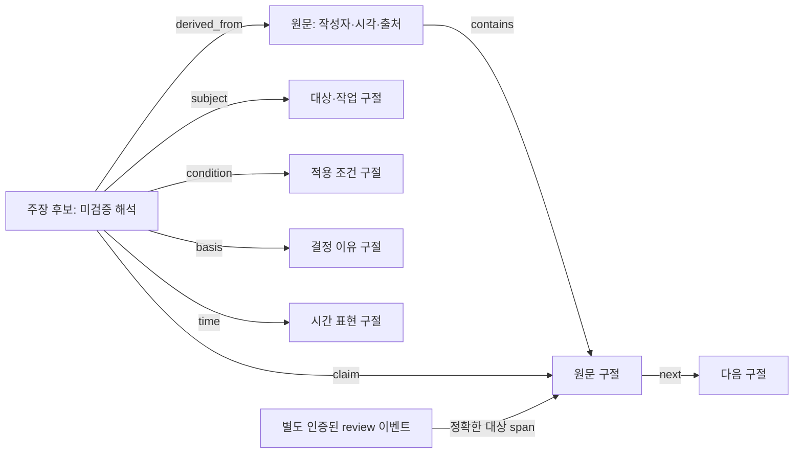

# records: 실제 실패에서 정한 연결 구조와 평가

2026-11-15. [범위 교정](records-quality-scope.md)을 구현하는 **opt-in 후보**다. 기본 경로를 교체하지 않았고, 좋은 구조가 곧 의미 정답을 보장한다고 주장하지 않는다.

**측정 후 결정:** vLLM 구조화 출력으로 형식 오류는 해소했지만 조건 연결과 QA에 퇴행이 남았다. [완료 결과](../../results/record-graph/README.md)에 따라 자동 역할 연결은 기본값으로 채택하지 않는다.

## 실패 → 필요한 정보 → 변경

아래는 [기존 실제 입력 진단](../../results/reference-qa/format-recovery-v1/retrieval-audit.json)과 [연결 실험의 실제 결과](../../results/reference-qa/connected-v1/README.md)에 근거한다. records 밖의 오류를 record 성과로 계산하지 않는다.

| 사례 | 실제 관찰 | records/후속 계약 |
|---|---|---|
| Ever F_SH_Top01_026 | Confluence 문구만 남기며 그 보고서의 경보 검증 작업명을 잃음 | 주장 → 작업/주제 구절 연결, 검색 hit의 문맥 확장 |
| Ever F_SH_Top02_014 | 작성자·수신자·업무 담당자 혼동, 필요한 마감 알림은 검색되지 않음 | author를 source metadata로 고정; 본문의 인물·업무 구절은 별도 subject 후보로 연결. 없는 알림을 graph가 찾았다고 주장하지 않음 |
| Ever F_TP_Top01_002 | 지난 금요일과 기록 날짜 혼동 | observed_at와 원문의 시간 표현 구분. 날짜를 임의 계산하지 않고 time 구절을 보존 |
| Ever MA_U_Top01_005 | 일반 정책만으로 잠긴 계정의 예외를 부정 | claim별 condition 연결. 예외 source가 검색되지 않은 실패는 retrieval에 남김 |
| Ever MA_P_Top02_083 | polling 유지 근거를 찾고도 즉시 전환을 승인하는 답 | 현재 polling의 이유/조건과 미래 전환 조건을 다른 주장에 연결. 근거 전달과 QA의 올바른 판단을 분리 평가 |
| writer 재검토 상태 | 올바른 재검토 상태를 받아도 정정으로 답함 | 기록 추출 그래프와 인증된 review 상태를 분리. 그래프만으로 이 QA 오류를 해결했다고 보지 않음 |

## 그래프인가?

**그래프 형태의 논리 구조다. 별도 그래프 DB는 아니다.** 기존 content-addressed JSON source에 선택적인 `record_graph`를 넣는다. 관계 목록은 Python/JSON만으로 읽을 수 있다. Neo4j 서버나 일반적인 entity graph를 추가하지 않는다.



`claim/condition/basis/time/subject`는 문서 전체의 태그가 아니라 **각 주장 후보에 붙는 edge**다. 현재 polling의 조건과 미래 WebSocket 전환의 조건을 한 목록으로 섞지 않는다. 사건·사람을 이름이 같다는 이유로 전역 병합하지 않는다. `speaker`는 원문 작성자이며 본문에서 언급한 인물과 같다고 가정하지 않는다.

첫 구현의 claim은 원문 문장 ID들의 묶음이다. 복합 문장이 자동으로 원자적 사실로 나뉘었다는 보장은 없다. 의미적 과잉 결합·누락은 평가할 오류다. 원문 모든 문장은 별도 unit으로 남고, 주장에 배정되지 않은 unit도 표시한다. `annotated`는 생성 완료일 뿐 완전한 추출이나 검증된 사실이라는 뜻이 아니다.

## 실제로 재사용한 것

| 참고 구현 | 재사용/변형 | 가져오지 않은 기능 |
|---|---|---|
| [LlamaIndex0.14.25 SentenceWindowNodeParser](https://github.com/run-llama/llama_index/blob/v0.14.25/llama-index-core/llama_index/core/node_parser/text/sentence_window.py) | **설치된 구현을 직접 실행.** sentence와 앞뒤3문장의 window. 기존 NLTK span을 전달하고, 공백으로 재결합한 문자열 대신 원문 offset으로 되돌림 | 문장 window를 의미적으로 검증된 조건으로 부르지 않음 |
| [LangChain FactWithEvidence 고정 원본](../../team_memory/_vendor/langchain_citation/citation_fuzzy_match_original.py) | 사실별 근거 결합 의도를 문장 ID 선택으로 변형. 기존 `review.comparison`의 ID→정확한 span 연결 방식을 재사용하는 설계 | QA runnable 전체 재현 아님. fuzzy match로 없는 구절을 맞추지 않음 |
| [Graphiti 고정 EntityEdge 구현](https://github.com/getzep/graphiti/blob/747b480ec6b12ecb718f1e2bc588b20ee36ea9c2/graphiti_core/edges.py) | episode 출처 연결, 기록 시각과 내용의 시간 의미를 구분하는 설계 참고 | Graphiti 코드/DB/검색/자동 무효화는 실행하지 않음. latest-wins 없음 |
| [vLLM0.8.5 structured outputs](https://docs.vllm.ai/en/v0.8.5/features/structured_outputs.html) | Pydantic 검증 schema를 `guided_json`으로 생성 시점에도 적용. v1의 ID 대신 문자열 생성 실패를 보고 별도 v2로 연결 | 문법 제한이 올바른 조건·시점 연결을 보장하지 않음. v1 실패를 재채점하지 않음 |

새 writer 프롬프트는 위 의도들을 우리 record 입력에 맞게 바꾼 후보다. 원 논문의 학습 효과나 전체 파이프라인 성능을 계승했다고 주장하지 않는다. 모델이 조건 관계를 잘못 고를 가능성은 원문 ID 검증으로 해결되지 않는다.

## 코드와 전달 경로

- [`records/graph.py`](../../team_memory/records/graph.py): 문장 window, 질문 없이 실행하는 writer, exact ID binding, 무결성 검증, 필요한 연결의 문맥 확장.
- `source.record_graph`: 별도 추출 schema. graph가 없는 원문도 유효하다. 자동으로 기존 불변 source를 수정하지 않는다.
- gateway는 선택적으로 source를 구성하고 그 결과를 intent와 함께 보존한 뒤 records에 제출한다. 같은 key 재시도는 보존된 결과를 사용한다.
- records가 원문과 그래프를 같은 immutable commit으로 저장한다. 실패한 추출도 원문과 failure 상태를 남긴다.
- relations는 원문 문장과 미검증 graph를 함께 받는다. 이전 source/history 범위 밖 근거를 쓸 수 없다.
- retrieval은 hit에 닿는 문장 window와 해당 claim의 조건/이유/시간/대상 구절까지 확장한다. 다른 source를 발견하는 기능이 아니다. 예산을 늘린 효과와 구분해야 한다.
- answering은 bundle에서 실제로 보이는 구절에 한해 record_context를 받는다. 지지 구절이 bundle 밖인 annotation은 숨긴다. canonical review_state는 별도로 전달된다.

추출 실패를 정상적인 empty claim으로 보고하지 않는다. 다만 raw fallback으로 답할 수 있다는 것과 그 답이 정확하다는 것은 다른 문제다. 긴 문서가 모델 예산을 넘기면 실패를 기록하며 임의 절단해서 추출 성공으로 보고하지 않는다.

## v1.2 계약과 사용

`team-memory.modules/v1.2`는 선택적인 `source.record_graph`와 그 하위 JSON Schema를 추가한다. 기존 `service.py` v2와 raw-source 경로는 유지한다. v1.1 envelope를 그대로 받는 호환 API는 아니므로 팀원의 schema/version도 함께 업데이트해야 한다. 기존 저장 history에는 graph 없는 source가 그대로 남는다.

```python
from functools import partial
from team_memory.records.graph import construct

# generate(system, content)는 기존 local Qwen 연결을 사용한다.
record_builder = partial(construct, generate=generate, model='Qwen3-8B@pinned-revision')
gateway = connect_v2(root, workspace_id=workspace, reader_factory=reader_factory,
                     generate=generate, record_builder=record_builder)
# 기본값 record_builder=None: 기존 원문 경로 유지.
```

vLLM0.8.5 연결에서는 `vllm_writer_kwargs`를 사용해 생성 단계에도 같은 schema를 적용한다.
기존 Qwen 클라이언트의 `additional_kwargs`에 다음 값을 전달하고, 그 writer의
`chat`을 위 `generate`에 연결한다. QA 클라이언트에는 추출 schema를 적용하지 않는다.

```python
from team_memory.records.graph import vllm_writer_kwargs
writer_options = vllm_writer_kwargs({
    'chat_template_kwargs': {'enable_thinking': False}, 'seed': 42,
})
# OpenAILike(..., additional_kwargs=writer_options)
```

model ID는 실제 설정을 기록해야 한다. 이 값 자체가 인증 증거는 아니다. 하나의 원문을 새 모델로 다시 구성하려면 기존 source를 덮어쓰지 않고 별도 실험 저장소를 사용한다. 복수 extractor revision을 운영 DB에서 관리하는 전용 API는 아직 없다.

## 평가와 현 상태

[고정 프로토콜](../../evaluation/record_graph/PROTOCOL.md), [입력](../../evaluation/record_graph/inputs.json), [서버에 보내지 않는 provisional key](../../evaluation/record_graph/key.json), [결과/실행 상태](../../results/record-graph/README.md).

원문22개를 질문 없이 먼저 처리한 뒤 같은9질문의 raw/linked QA를 비교한다. 기존 실패에서 결정적 source를 골랐으므로 oracle-source 개발 진단이며 검색 성능이나 unseen 일반화가 아니다. 추가 writer 호출과 annotation 토큰을 비용에 포함한다. 자동 role coverage와 원문 보존을 의미 정확도로 바꾸지 않는다. 원문에 없는 역할 연결·누락·상태 승격·QA 정답/인용을 원문과 별도로 검토해야 채택 판단을 한다.
