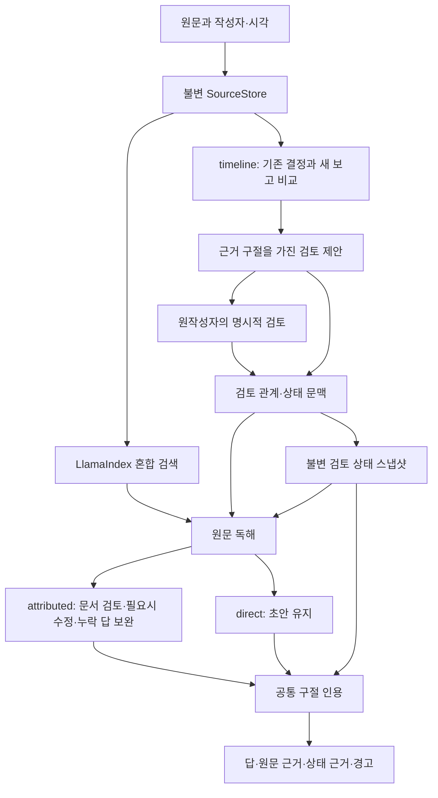

# 2026-11-08 구현·실험 상태 상세 기록

2026-11-14 저장소 구조 정리 전 README의 상세 결과를 보존한 문서다. 최신 진입점은 [README](../README.md)를 따른다.

# Evidence-Bounded Team Memory

[](https://github.com/ashcircle03/evidence-bounded-team-memory/actions/workflows/tests.yml)

**각자 AI와 작업하는 팀이 Git으로 기록을 공유할 때, 과거 결정의 조건·근거·승인 상태를 잃지 않고 다시 활용하기 위한 연구 프로토타입.** 원문을 보존하고 새 보고와 과거 결정을 비교하며, 작성자가 검토할 제안과 근거를 추적할 수 있는 답을 만든다.

[전체 연구 이력](../docs/research-history.md) · [설계와 레퍼런스](../docs/current-design.md) · [입출력 명세](../docs/service-v2.md) · [평가·재현 안내](../docs/evaluation-guide.md) · [모든 보고서](../docs/INDEX.md)

## 현재 상태 — 2026-11-08

팀원 연결용 진입점은 **`python -m team_memory.service`**다. 기본 reader는 `attributed`, 단순 비교 경로는 `--reader direct`다. 원문 검색·QA와 기존 timeline의 제안·작성자 검토를 연결했으며, 검토 상태 설명에도 실제 제안·투표 스냅샷을 인용할 수 있다. UI·MCP·Git 전송·사용자 인증은 호출자가 맡는다.

**오픈소스 서비스의 상태 관리 방식을 검토해 전달·인용 경계를 수정했지만, 전체 완성 기준은 아직 미달이다.** Mem0의 현재값/이력, Graphiti의 주장별 출처, LangChain HITL의 제안/실행 구분을 참고했다. 실제 실행 라이브러리인 LlamaIndex에는 검토 스냅샷도 초기 생성부터 번호가 붙은 근거로 연결했다. 이들 서비스 전체를 설치·재현했다는 뜻은 아니다.

| 최근 실제 Qwen3-8B 검증 | 결과 |
|---|---:|
| 기존20, 전체 원문에서 새 검색·추론, 핵심 답+필요 근거 | 20/20 |
| 알려진 합성11 QA시점, 답+엄격한 필요 근거 | 8/11 |
| 추가 합성6 QA시점, 답+필요 근거 | 6/6 |
| 위17 중 상태 적용을 직접 묻는8시점, 값·상태 및 검토 기록 인용 | 8/8 |
| 재검토 양성2건의 올바른 관계 종류 | 0/2 |
| 무관한 보고2건의 불필요 제안 | 2/2 |

기존20의 정답 키에 적힌 위치와 직접 일치한 것은19개다. 나머지 `grep.extendedRegexp`는 같은 원문 파일의 인접 문단이 답과 적용 조건을 지지하는지 따로 검토했다. 부연 문장마다 인용이 완벽하다는 점수는 아니다. 합성17은 수정 과정에서 재사용한 개발/회귀 사례이며, 구현한 AI의 비독립 평가다. 기존20에는 자연 EverMem3문항이 포함되며 EverMem/Wiki 전수 성능은 아니다.

기본 서비스·QA는 `cup-completion-v3b`의 모델 판단 경로를 유지한다. 후속 [입출력 경계 수정](../results/module-boundary/README.md)은 원문 위치 보존·후보별 실패 분리·재검토 승인 효과 전달을 고쳤고, 새 Qwen 실행에서 위37개 답·근거를 모두 유지했다. 재검토 분류0/2와 불필요 제안2/2는 그대로다. v4 후보는 필수 구절 선택 필드 누락과 관계 오분류 때문에 채택하지 않았다. 재검토 판단을 자동 승인·자동 병합에 사용할 준비가 됐다고 주장하지 않는다.

최신 [비교기8B/14B와 실제QA 연결 시험](../results/comparator-choice/README.md)도 완료했다. 14B는 새 합성 재검토를0/4→3/4로 늘렸지만 상충4/4→0/4, 공존3/4→2/4로 퇴보해 **전면 교체하지 않았다**. QA는 같은8B를 유지했으며 기존20의 핵심 답·근거는20/20, 정정·상태8은8/8→7/8이었다. 출입 허가 변경1흐름은 제안부터 승인 전후QA까지 성공했지만, 올바른 재검토를 직접 넣어도 일부QA가 이를 정정으로 설명했다. 기본 모델과 운영 코드는 유지한다. Qwen3-8B와 Qwen2.5-14B-Instruct 비교이므로 순수 모델 크기 효과는 아니다.

후속 [원문 근거 패치 실험](../results/source-patch/README.md)에서는 Trustcall의 기존 문서 패치 방식, Graphiti의 관계 타입 검사, vLLM 구조화 출력을 적용했다. 두 후보 모두 기존20은 유지했지만 상태·인용 회귀가 생겨 **채택하지 않았다**. 두 번째 후보는 재검토 양성2건을 회복했으나 일반 사실을 결정으로 오인했고, 승인 후 온도를45C 대신40C로 답했다. 당시 기본 서비스·QA 경로는 v3b로 복구했다. 이 실험으로 기존 재검토 오분류가 해결됐다는 주장은 하지 않는다.

[이번 구현·실패·전체 원출력](../results/service-completion/README.md) · [오픈소스 파일별 적용 이유](../docs/service-completion-design.md) · [판정 기록](../results/service-completion/decision.json)

### 앞선 reader 비교 — 이번 수정 전

같은 Qwen3-8B, 같은 근거와 최초 프롬프트로 43쌍·86개 답을 비교했다. 아래는 **핵심 답 + 필요한 근거**를 모두 맞힌 수다.

| 평가 범위 | direct | attributed |
|---|---:|---:|
| 새 EverMemBench-Dynamic 6문항 | 2/6 | 2/6 |
| 새 WikiContradict 6문항 | 1/6 | 3/6 |
| 새 합성 8흐름의 11개 QA 시점 | 7/11 | 9/11 |
| 기존 개발 20문항, 새 동일근거 추론 | 17/20 | 20/20 |

- 새 23개 QA에서 attributed가 4개 더 성공했고 direct의 성공을 잃지 않았다. 그러나 QA 호출은 **37→127회, 3.43배**로 사전 비용 기준인 2배를 넘었다.
- direct는 기존 20개 중 3개를 잃었다. 따라서 기존 기본값 attributed는 호환성을 위해 유지하고 direct의 전면 교체는 하지 않는다.
- Ever/Wiki는 선택된 원본 데이터셋 문항의 **동일 근거 reader 비교**다. 전체 벤치마크나 배포 hybrid 검색 전체의 성능이 아니다. 합성 흐름은 실제 서비스 경로를 실행했다.
- 구현에 참여한 AI가 arm 이름을 가린 카드로 원문을 검토했다. 독립 사람 평가가 아니다. 모든 부연 문장의 인용이 완벽하다는 점수도 아니다.
- 실제 비교 332회 + 알려진 상태 인용 수정 2회 호출. 실패·준비 포함 **21.72 GPU분**. 원출력·실패·채점 이유를 함께 공개한다.

[최종 보고서](../results/service-v3/README.md) · [43쌍 질문·답·근거 판정](../results/service-v3/cases.md) · [사전 기준](../results/service-v3/PROTOCOL.md) · [적용 결정](../results/service-v3/deployment-decision.json)

### 남은 문제

1. 새 조건에 대한 결과를 옛 조건의 사실을 뒤집는 정정으로 오분류한다. 상태·인용 연결이 정확해도 이 의미 오류는 남는다.
2. 기존 판단 이유를 바꾸지 않는 보고에도 불필요한 정정 제안을 만든다.
3. 답의 일부 부연 설명·인용 단위가 불완전하다. 실행 상태 `ok`는 의미 정답 보장이 아니다.
4. 자연 QA 검색·시간 계산의 일반화는 별도 문제다. 이번 변경으로 이전 EverMem/Wiki 실패가 모두 해결됐다고 볼 수 없다.

## 해결하려는 문제

실험에서 한 설정을 기각한 기록은 특정 조건에서의 판단이다. 나중에 다른 조건의 팀원 결과가 들어왔을 때 과거 결정을 영구적인 금지처럼 읽으면 재검토 기회를 놓친다. 반대로 새 보고를 무조건 최신 정답으로 덮어써도 안 된다.

이 시스템의 목표는 다음과 같다.

- **근거 있는 QA:** 누가, 언제, 어떤 조건에서 무엇을 관측했는지 원문 구절과 함께 답한다.
- **검토 제안:** 새 근거가 과거 결정의 이유를 바꾸는지 설명하고 원작성자에게 제안한다. AI 제안은 승인이 아니다.
- **조건·상태 보존:** 다른 조건의 결과는 공존할 수 있고, 같은 조건의 상충은 해결 전까지 양쪽을 남긴다. 정정·재검토·공존을 구분한다.
- **협업:** 각 팀원의 checkout에 독립 AI가 있다. 공유 AI를 전제하지 않고 원문·제안·투표를 Git으로 전달한다.

Aimers 경험은 문제를 발견한 동기다. 초기 Aimers 사례, 공개 Git/PEP 사건, 자연 QA, 합성 흐름을 같은 종류의 성능 증거로 합산하지 않는다.

## 현재 경로



[모듈별 책임과 재사용 이유](../docs/current-design.md)에서 라이브러리·저자 코드 재사용, 논문 아이디어 변형, 프로젝트 고유 연결부를 구분한다. 모든 입력에 모든 단계가 필요한 것은 아니다. 추가 단계의 성과와 비용은 위 비교에 함께 기록했다.

## 시작하기

모델 없이 Git 공유·검토 절차만 확인하는 **고정 응답 데모**:

```sh
git clone https://github.com/ashcircle03/evidence-bounded-team-memory.git
cd evidence-bounded-team-memory
python3 -m team_memory demo
python3 -m team_memory demo --followup
```

이 데모는 가상 관측·승인·고정 응답을 사용한다. 실제 모델의 성능 검증이 아니다.

실제 서비스는 Python 환경에 [고정 의존성](../requirements-reference.txt), NLTK 자료, 로컬 Qwen·임베딩과 OpenAI 호환 로컬 모델 서버가 필요하다.

```sh
python -m team_memory.service \
  --store /path/to/checkout/shared-records \
  --model-path /path/to/Qwen3-8B \
  --embedding-path /path/to/embedding \
  --api-base http://127.0.0.1:PORT/v1 \
  --reader attributed < requests.jsonl > responses.jsonl
```

```json
{"operation":"import_history","records":[{"owner":"Alice","observed_at":"2026-01-01T00:00:00Z","source":{"speaker":"Alice","location":"git://notes/1","text":"With one worker, caching did not improve latency."}}]}
{"operation":"ask","question":"Under which condition did caching fail to improve latency?","temporal_scope":"historical"}
```

[전체 연동 명세](../docs/service-v2.md) · [상태 인용 자료형](../docs/review-state-citations.md) · [환경·평가 재현](../docs/evaluation-guide.md). `status=ok`는 실행과 구조 처리의 상태이며 의미 정답 인증이 아니다. Aurora에서는 GPU 계산 노드와 conda를 사용하고, 로그인 노드에서 전처리·추론을 하지 않는다.

## 저장소 안내

| 경로 | 내용 |
|---|---|
| [`team_memory/`](../team_memory/) | 현재 서비스, 공유 저장·검토, QA, 과거 실험 구현 |
| [`team_memory/_vendor/`](../team_memory/_vendor/) | 실제 재사용한 공개 코드·프롬프트·라이선스 |
| [`docs/`](../docs/INDEX.md) | 설계 의도, 연결 계약, 감사, 전체 연구 이력 |
| [`evaluation/`](../evaluation/) | 입력 구성·고정 기준·검증·채점 코드 |
| [`results/`](../results/README.md) | 단계별 실패와 성공, 원출력, 인용, 채점 이유, 비용 |
| [`tests/`](../tests/) | 저장·상태·전송·인용·공개 패키지 계약 검사 |
| [`evaluation/qa20/`](../evaluation/qa20/) | 기존 QA20의 휴대 가능한 자료 묶음 |

SpeakerMem-R1, CUPMem, 여러 QA 후보는 [연구 이력](../docs/research-history.md)에 역할과 채택 여부를 남겼다. 과거 문서의 “현재/최신”은 당시 상태다. 운영 연결은 이 README와 service 명세를 기준으로 한다.

## 기여와 이용 범위

[기여 안내](../CONTRIBUTING.md)에 검사 환경과 실험 변경 규칙이 있다. 팀 코드의 재사용 라이선스는 아직 팀과 결정 중이다. 공개 저장소라는 이유만으로 별도 오픈소스 라이선스를 부여하지 않는다. 가져온 코드·프롬프트·데이터는 각 원출처와 해당 라이선스를 따른다. 모델 가중치·비밀키·개인 인증정보는 포함하지 않는다.
