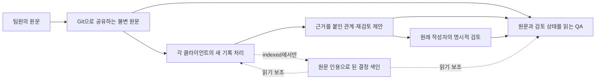

# 시간순 기록과 검토를 연결하는 최소 시스템

비교를 완료했고 기본 경로는 `direct`로 정했다. 같은 Qwen2.5-14B에서 자동 색인은 필요한 검토와 기존 QA 보존의 사전 채택 기준을 통과하지 못했다. [결과](../../results/timeline/README.md)와 [설계 판단·품질 한계](../../results/timeline/interpretation.ko.md)를 함께 읽는다. 이 구현은 자동 재검토와 누적 QA의 오류가 남아 있는 연구 프로토타입이다.

두 경로 모두 원문 전체를 유지한다. `direct`는 현재까지 도착한 기록과 실제 검토 상태를 한 번에 읽는다. `indexed`는 여기에 기록 도착 시 자동 추출한 결정·근거·조건의 원문 인용 색인을 추가한다. 색인은 원문이나 승인 기록을 대신하지 않는다.



처리 위치는 클라이언트별 비공개 상태다. 다른 팀원의 AI가 한 번 처리한 기록도 내 과거 맥락에서는 새로 비교해야 하므로 이 위치를 Git으로 공유하지 않는다. CLI는 이를 해당 체크아웃의 `.git` 내부에 저장한다. 프로그램 API의 기본 위치는 공유 기록 폴더 밖의 `.timeline-client-*`이며 Git에서 제외한다.

공유하는 것은 `sources`, `timeline_index`, `timeline_proposals`, `timeline_votes`다. `view`는 도착한 공유 상태를 보여주고, 추론은 해당 클라이언트가 처리한 시점의 스냅샷만 받는다. 처음 사용하는 클라이언트의 `pull`은 원문 관측 시각 순으로 초기 기록을 처리한다. 이 프로토타입은 순차 유입을 평가하며, 동시에 들어오는 작성 작업이나 매우 늦게 도착한 과거 결정 전체에 대한 재계산 정책은 별도 검증이 필요하다.

## 사용하는 방법

원문 JSON 형식은 기존 `capture`와 같다. 사람이 issue, scope, 정답 관계를 작성하지 않는다.

```json
{
  "owner": "Mina",
  "observed_at": "2026-11-05T15:00:00+09:00",
  "source": {
    "speaker": "Mina",
    "location": "worklog://exporter/2026-11-05",
    "text": "With four workers the exporter took 12 seconds. Deployment now permits four workers. The earlier one-worker result remains unchanged."
  }
}
```

```sh
# Aurora에서는 아래 모델 명령을 Slurm 계산 노드에서 실행한다.
python -m team_memory.timeline_cli --store shared-records --mode direct \
  ingest report.json --model /path/to/model
git add shared-records
git commit -m 'Publish source and proposed review'
git push

# 다른 체크아웃의 클라이언트
python -m team_memory.timeline_cli --store shared-records --mode direct \
  pull --model /path/to/model
python -m team_memory.timeline_cli --store shared-records view
python -m team_memory.timeline_cli --store shared-records --mode direct \
  ask 'What runtimes were measured under each worker configuration?' --model /path/to/model

# 원래 작성자가 정확한 제안 ID를 검토한 뒤 기록한다.
python -m team_memory.timeline_cli --store shared-records review PROPOSAL_ID ORIGINAL_OWNER approve
```

공개 이름의 `owner`는 원문의 작성자를 나타낸다. 이 프로토타입은 검토 명령의 작성자 필드가 원작성자와 일치하는지 검사한다. 그 필드를 실제 GitHub 사용자 신원과 연결하는 인증 연동은 구현하지 않았다. 평가의 원작성자 검토도 명시된 시점에 수행하는 모의 사용자 행동이다. `approve`는 제안 종류에 따라 의미가 다르다. `reconsider` 승인은 재검토할 이유를 인정하며 과거 관측을 지우지 않는다. `correction` 승인은 정확한 옛 구절과 정정 구절을 연결한다. 같은 파일의 다른 사실은 여전히 사용할 수 있다. 승인되지 않은 보고도 출처와 잠정 상태를 붙여 읽을 수 있다.

모드를 바꿔 비교할 때는 별도의 클라이언트 상태·기록 폴더를 사용한다. 현재 기본 QA와 이전 연구 모듈을 자동으로 바꾸지 않았다.

## 검증

`tests/test_timeline.py`는 출처·부분 정정·승인·클라이언트별 처리 경계와 미래 원문 누출을 검사한다. `tests/test_timeline_git.py`는 고정 응답으로 실제 bare remote와 두 복제본의 동작을 검사한다. 이 단위 테스트는 모델 성능 증거가 아니다. 실제 Qwen 출력에 대해서도 개발 110회·최종 540회 호출을 `evaluation.timeline.git_replay`로 재생해 입력 일치와 두 복제본의 상태 수렴을 확인했다.

[사전 평가 기준](PROTOCOL.md)에서 데이터 변형, 전체 스트림 예산, 채택 기준과 중단 조건을 확인할 수 있다. 자연 대화 QA와 합성 작업 기록의 성과는 구분해서 보고한다.

[출력 확인 전 동결](EARLY_FREEZE.md)에 따라 개발 출력으로 프롬프트를 수정하지 않는다. 최종 구성은 20개 흐름, 방식별 140개 QA 시점이며, 같은 자연 질문의 반복 확인을 독립 문항 수로 세지 않는다. `validate_data`의 280개 검사는 정답 응답을 넣어 입력·채점·상태 전이가 일치하는지 검사하는 것으로 모델 성과가 아니다.

```sh
python3 -m evaluation.timeline.validate_data
# 해당 Slurm 작업이 실제 종료되고 결과가 회수된 후
python3 -m evaluation.timeline.verify development
python3 -m evaluation.timeline.git_replay evaluation/timeline/development.json \
  results/timeline/development-generations.json results/timeline/development-git.json
python3 -m evaluation.timeline.score results/timeline/development-generations.json \
  evaluation/timeline/development-key.json results/timeline/development
```

`blind-cards.json`의 제안 이유와 두 원문을 사전 기준으로 검토하고 `ratings.json`에 판단·근거를 기록한다. 같은 명령은 최종 입력과 결과에도 적용한다. 실행·자료 검증만으로 필요한 재검토를 올바르게 판단했다고 결론 내리지 않는다.

완료된 최종 결과는 다음과 같이 재검증할 수 있다. 캠페인 폴더의 원래 제출 파일·실행 결과가 필요하며, 이 명령들은 새 GPU 작업을 제출하지 않는다.

```sh
python3 -m evaluation.timeline.verify final
python3 -m evaluation.timeline.score results/timeline/final-generations.json \
  evaluation/timeline/final-key.json results/timeline/final
python3 -m evaluation.timeline.git_replay evaluation/timeline/final.json \
  results/timeline/final-generations.json results/timeline/final-git.json
python3 -m evaluation.timeline.decision
```

`decision`은 수치와 보고서 초안을 재생성한다. 최종 해석·표현 차이 진단·채점 민감도는 `results/timeline/interpretation.ko.md`, `diagnostics.json`, `sensitivity.json`에 별도로 보존한다. 의미 채점은 단일 AI 평가이며 독립 평가자 일치도를 측정하지 않았다.
